<picture>
  <source media="(prefers-color-scheme: dark)" srcset="./assets/profile-hero-dark.svg" />
  <source media="(prefers-color-scheme: light)" srcset="./assets/profile-hero-light.svg" />
  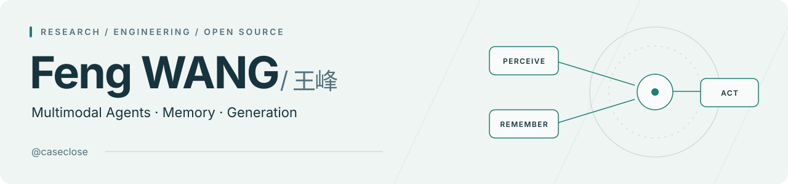
</picture>

       

  
  

  
  
  

## About Me

<h3>Research & Work</h3>

- 🔭 I'm currently working on: **Agent(@WeChat Xiaowei, 小微)** · **WeLM-Image-V1(@WeChat Xiaowei, 微信小微生图/编辑模型)** · **GUI Agent** · **Multimodal Understanding (VLM)** · **Code-driven Generation** · **AIGC**
- 🌱 I'm currently learning: Agentic systems / Harness & unified multimodal models & code generation (HTML / CSS / SVG / LaTeX) · 📈 stock investing

- 🛠️ I actively contribute to the open-source community as a **Contributor** to [OpenCode](https://github.com/anomalyco/opencode), an open-source agent harness, focusing on plugin runtimes, developer-tool integration, and interaction consistency through bug analysis and regression tests.

<h3>Education</h3>

 &nbsp; <b>Peking University</b> · M.S. in Computer Science and Technology School of Electronic and Computer Engineering · 2024.09 – 2027.06

 &nbsp; <b>Harbin Institute of Technology</b> · B.S. in Computer Science (Information Security) Honors School · 2020.09 – 2024.06 · <b>Rank 2 / 82</b>

## Open Source & Projects

<table width="100%">
<tr><td colspan="2">

01 / MULTIMODAL AGENT RESEARCH

<h3><a href="https://caseclose.github.io/cma-harness/">CMA-Harness</a></h3>

<b>Cognitive-structured Multimodal Agent Harness.</b> A memory-centric agent for long-horizon multimodal understanding, generation, and editing, with M2CA-Bench. Externalizes visual history into episodic memory with selective retrieval.

  

</td></tr>
<tr><td colspan="2">

02 / OPEN-SOURCE CONTRIBUTION

</td></tr>
<tr>
<td width="50%" valign="top">
<h3><a href="https://github.com/anomalyco/opencode">OpenCode</a></h3>

Contributions cover plugin API cancellation with <code>AbortSignal</code>, Composer-based Pint resolution, and consistent question policies and keyboard navigation, backed by regression tests.

 <a href="https://github.com/anomalyco/opencode/pulls?q=is%3Apr+author%3Acaseclose">View all PRs</a>

</td>
<td width="50%" valign="top">
<h3><a href="https://github.com/MLNLP-World/Top-AI-Conferences-Paper-with-Code">Top AI Papers with Code</a></h3>

Contributor to <b>MLNLP-World / Top-AI-Conferences-Paper-with-Code</b>, a collection of papers and code from leading AI conferences.

</td>
</tr>
<tr><td colspan="2">

03 / AGENT SKILLS

<h3><a href="https://github.com/caseclose/my-skill-hub">My Skill Hub</a></h3>

A collection of open-source agent skills I created.

<ul>
<li><a href="https://github.com/caseclose/computer-use-skill"><b>Computer Use Skill</b></a> — Browser &amp; macOS app automation</li>
<li><a href="https://github.com/caseclose/html-viewer-skill"><b>HTML Viewer</b></a> — Local data pages &amp; dashboards</li>
<li><a href="https://github.com/caseclose/gpu_utl_occupy_skill"><b>GPU Occupy</b></a> — Controlled GPU workloads &amp; utilization</li>
</ul>

</td></tr>
</table>

<table width="100%">
<tr>
<td width="50%" valign="top">

04 / DESKTOP COMPANIONS

<h3><a href="https://caseclose.github.io/kimi-work-pets/">Kimi Work Pets</a></h3>

One-click installation of 14 Codex Pets community sprites for Kimi Work. Hover interactions and gaze-following head tracking on macOS &amp; Windows.

 

</td>
<td width="50%" valign="top">

05 / EVERYDAY TOOLS

<h3><a href="https://github.com/caseclose/work-encourager-open">Work Encourager</a></h3>

A real-time earnings tracker that turns working minutes into visible progress and motivating goals. Web app and native macOS menu bar utility.

  

</td>
</tr>
<tr>
<td width="50%" valign="top">

06 / TASK MANAGEMENT

<h3><a href="https://caseclose.github.io/cadence/">Cadence</a></h3>

A CPU-scheduling-inspired task manager for multi-task life, with task suspension and adaptive backoff polling reminders.

 

</td>
<td width="50%" valign="top">

07 / MARKET DASHBOARD

<h3><a href="https://github.com/caseclose/stock-assistant">Stock-assistant</a></h3>

US equities reference dashboard: watchlists, multi-timeframe charts, and composite signals. FastAPI · Next.js · Alpaca

 

</td>
</tr>
<tr>
<td width="50%" valign="top">

08 / NATIVE MACOS

<h3><a href="https://github.com/caseclose/YouTubeMusic-MacOS">YouTubeMusic-MacOS</a></h3>

A native YouTube Music desktop client with media keys, menu bar tray, and Control Center integration.

 

</td>
<td width="50%" valign="top">

09 / WRITING TOOLS

<h3><a href="https://github.com/caseclose/mymd-editor">Mymd-editor</a></h3>

A Typora-style Markdown editor for Windows. Electron · Milkdown

 

</td>
</tr>
</table>

## Tech & Tools

<b>Models &amp; training</b>

  
  <a href="https://github.com/modelscope/ms-swift" title="ms-swift">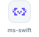</a>
  <a href="https://github.com/vllm-project/vllm" title="vLLM">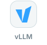</a>
  <a href="https://github.com/volcengine/verl" title="verl">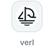</a>

<b>Code &amp; interfaces</b>

  <a href="https://www.python.org" title="Python">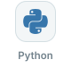</a>
  
  <a href="https://isocpp.org" title="C++">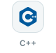</a>
  <a href="https://www.typescriptlang.org" title="TypeScript">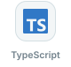</a>
  <a href="https://react.dev" title="React">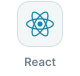</a>
  
  <a href="https://developer.mozilla.org/en-US/docs/Web/CSS" title="CSS">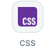</a>
  
  <a href="https://git-scm.com" title="Git">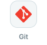</a>

<b>AI coding</b>

  
  
  
  <a href="https://www.kimi.com/code" title="Kimi Code">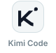</a>
  
  <a href="https://zcode.z.ai" title="ZCode">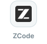</a>

## GitHub Activity

  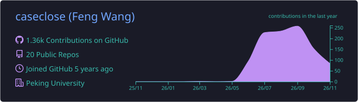

  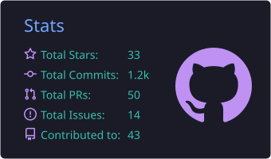
  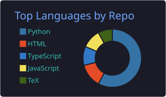

  <picture>
    <source media="(prefers-color-scheme: dark)" srcset="https://raw.githubusercontent.com/caseclose/caseclose/output/github-contribution-grid-snake-dark.svg" />
    <source media="(prefers-color-scheme: light)" srcset="https://raw.githubusercontent.com/caseclose/caseclose/output/github-contribution-grid-snake.svg" />
    
  </picture>

