<picture>
  <source media="(prefers-color-scheme: dark)" srcset="./assets/profile-hero-dark.svg" />
  <source media="(prefers-color-scheme: light)" srcset="./assets/profile-hero-light.svg" />
  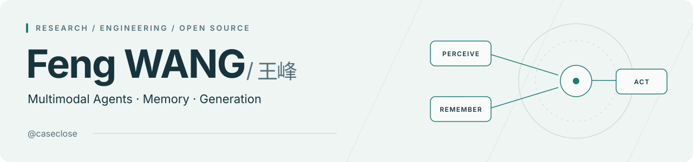
</picture>

<b>研究多模态智能体与记忆机制，也制作日常用得上的工具。</b>

       

  
  

  <a href="#开源项目与代表作" title="开源项目与代表作">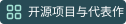</a>
  
  

## 关于我

<b>微信小微 / WeChat Xiaowei</b> Agent · WeLM-Image-V1（生图与编辑模型）

多模态 Agent · GUI Agent · 多模态理解（VLM） 强化学习 · 代码驱动数据合成 · AIGC

持续探索 Agentic Systems / Harness、统一多模态模型，以及 HTML / CSS / SVG / LaTeX 代码生成；也在学习美股量化与投资。

<h3>教育背景</h3>

 &nbsp; <b>北京大学</b> · 计算机科学与技术硕士研究生 信息工程学院 · 2024.09 – 2027.06

 &nbsp; <b>哈尔滨工业大学</b> · 信息安全（计算机类）学士 英才荣誉学院 · 2020.09 – 2024.06 · <b>专业排名 2 / 82</b>

## 开源项目与代表作

<table width="100%">
<tr><td>

01 / 多模态智能体研究

<h3><a href="https://caseclose.github.io/cma-harness/">CMA-Harness</a></h3>

<b>认知结构化多模态智能体框架。</b>面向长程多模态理解、生成与编辑，将视觉历史外置为情景记忆并进行选择性检索，附 M2CA-Bench 基准。

  

</td></tr>
<tr><td>

02 / 开源贡献

<h3><a href="https://github.com/MLNLP-World/Top-AI-Conferences-Paper-with-Code">Top AI Papers with Code</a></h3>

<b>MLNLP-World / Top-AI-Conferences-Paper-with-Code</b> 贡献者，参与顶会论文与代码汇总。

</td></tr>
<tr><td>

03 / AGENT 技能

<h3><a href="https://github.com/caseclose/my-skill-hub">My Skill Hub</a></h3>

我个人制作的开源 Agent Skills 仓库。

<ul>
<li><a href="https://github.com/caseclose/computer-use-skill"><b>Computer Use Skill</b></a> — 浏览器与 macOS 原生应用自动化</li>
<li><a href="https://github.com/caseclose/html-viewer-skill"><b>HTML Viewer</b></a> — 本地数据网页与看板</li>
<li><a href="https://github.com/caseclose/gpu_utl_occupy_skill"><b>GPU Occupy</b></a> — GPU 可控负载与利用率调节</li>
</ul>

</td></tr>
</table>

<table width="100%">
<tr>
<td width="50%" valign="top">

04 / 桌面伙伴

<h3><a href="https://caseclose.github.io/kimi-work-pets/">Kimi Work Pets</a></h3>

为 Kimi Work 一键安装 14 款 Codex Pets 社区精灵，支持悬停交互与视线跟随转头，适配 macOS / Windows。

 

</td>
<td width="50%" valign="top">

05 / 日常工具

<h3><a href="https://github.com/caseclose/work-encourager-open">Work Encourager</a></h3>

把每一分钟的工作转化为可视化收入进度与目标反馈，提供交互式网页版和 macOS 原生菜单栏应用。

  

</td>
</tr>
<tr>
<td width="50%" valign="top">

06 / 任务管理

<h3><a href="https://caseclose.github.io/cadence/">Cadence</a></h3>

受操作系统 CPU 调度启发的多任务时间管理器，支持任务挂起与自适应退避轮询提醒。

 

</td>
<td width="50%" valign="top">

07 / 行情看板

<h3><a href="https://github.com/caseclose/stock-assistant">Stock-assistant</a></h3>

美股多周期看板与综合信号分析系统，包含自选股、多周期图表与综合信号。 FastAPI · Next.js · Alpaca

 

</td>
</tr>
<tr>
<td width="50%" valign="top">

08 / 原生 MACOS

<h3><a href="https://github.com/caseclose/YouTubeMusic-MacOS">YouTubeMusic-MacOS</a></h3>

原生 macOS YouTube Music 桌面客户端，支持媒体键、状态栏托盘与控制中心集成。

 

</td>
<td width="50%" valign="top">

09 / 写作工具

<h3><a href="https://github.com/caseclose/mymd-editor">Mymd-editor</a></h3>

Typora 风格的 Windows Markdown 编辑器。 Electron · Milkdown

 

</td>
</tr>
</table>

## 技术与工具

<b>模型与训练</b>

  
  <a href="https://github.com/modelscope/ms-swift" title="ms-swift">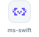</a>
  <a href="https://github.com/vllm-project/vllm" title="vLLM">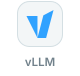</a>
  <a href="https://github.com/volcengine/verl" title="verl">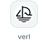</a>

<b>代码与界面</b>

  <a href="https://www.python.org" title="Python">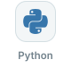</a>
  
  <a href="https://isocpp.org" title="C++">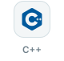</a>
  <a href="https://www.typescriptlang.org" title="TypeScript">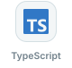</a>
  <a href="https://react.dev" title="React">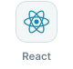</a>
  
  
  
  <a href="https://git-scm.com" title="Git">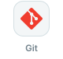</a>

<b>AI 编程工具</b>

  
  
  
  
  
  <a href="https://zcode.z.ai" title="ZCode">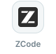</a>

## GitHub 贡献动态

  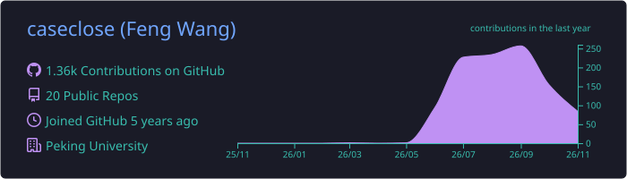

  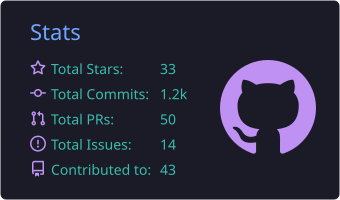
  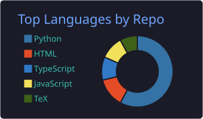

  <picture>
    <source media="(prefers-color-scheme: dark)" srcset="https://raw.githubusercontent.com/caseclose/caseclose/output/github-contribution-grid-snake-dark.svg" />
    <source media="(prefers-color-scheme: light)" srcset="https://raw.githubusercontent.com/caseclose/caseclose/output/github-contribution-grid-snake.svg" />
    
  </picture>

